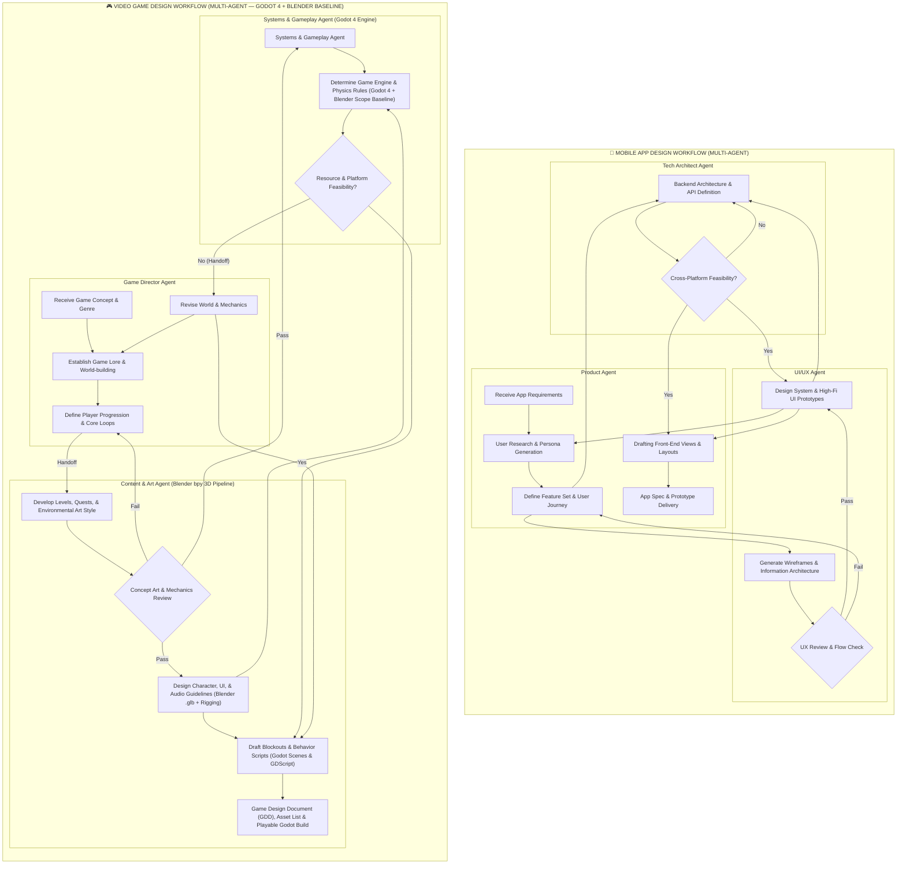

# ⚡ Multi-Agent Workflows for Design & Development Baseline (Mobile App & Godot 4 + Blender Game Pipeline)

> **Core Directive**: Orchestrate multi-agent role separation across **Mobile App Design** (`Product Agent`, `UI/UX Agent`, `Tech Architect Agent`) and **Video Game Design** (`Game Director Agent`, `Content & Art Agent`, `Systems & Gameplay Agent`), enforcing **Godot 4 + Headless Blender (`bpy`)** as the baseline game engine and 3D asset/animation pipeline whenever game development matches the project scope.

---

## 1. Multi-Agent Architecture Overview

All application and video game design/development tasks follow a deterministic, gate-checked 3-agent orchestration pipeline with explicit pass/fail feedback loops before final delivery.



---

## 2. Mobile App Design Workflow (Multi-Agent)

| Agent Role | Core Responsibilities | Quality Gates & Handoffs |
| :--- | :--- | :--- |
| **Product Agent** | 1. **Receive App Requirements**<br>2. **User Research & Persona Generation**<br>3. **Define Feature Set & User Journey**<br>4. **Drafting Front-End Views & Layouts**<br>5. **App Spec & Prototype Delivery** | Hands off defined feature sets to both the **UI/UX Agent** and **Tech Architect Agent** in parallel. Receives validated UI systems and cross-platform architecture to assemble front-end views (`Expo / React Native` + `Web`). |
| **UI/UX Agent** | 1. **Generate Wireframes & Information Architecture**<br>2. **UX Review & Flow Check** *(Pass/Fail Gate)*<br>3. **Design System & High-Fi UI Prototypes** | If **UX Review & Flow Check** fails, loops back to `Define Feature Set & User Journey`. On **Pass**, produces High-Fi UI prototypes adhering to WCAG AAA contrast, $48 \times 48\text{dp}$ touch targets, and zero emoji asset flips. |
| **Tech Architect Agent** | 1. **Backend Architecture & API Definition**<br>2. **Cross-Platform Feasibility?** *(Yes/No Gate)* | Evaluates whether the stack (`Expo SDK`, `React Native`, `TypeScript`, `AsyncStorage`, `WebAudio/Haptics`) runs cleanly across iOS, Android, and Web. If **No**, refactors backend/API definitions before approving front-end layout drafting. |

---

## 3. Video Game Design Workflow (Multi-Agent) — Godot 4 & Blender Baseline

Whenever a game development request matches the scope of 2D/3D action, martial arts, roguelike deckbuilders/climbers, tactical board combat, or stylized 3D arenas, **Godot 4 + Blender (`bpy`)** is enforced as the default baseline engine and 3D asset pipeline.

### 3.1 Role Responsibilities & Gate Loops

1. **Game Director Agent**:
   - **Receive Game Concept & Genre**: Defines the core fantasy, combat pillars, and target audience.
   - **Establish Game Lore & World-building**: Crafts authentic cultural/mythic world-building, faction identities, and distinct character archetypes (zero generic AI purple prose).
   - **Define Player Progression & Core Loops**: Designs asymmetric character kits, turn/real-time resource economies, relic synergies, and MMR/floor progression.
   - **Revise World & Mechanics**: Triggered whenever `Resource & Platform Feasibility?` returns **No**, rebalancing scope and feeding directly back into world-building and blockout scripting.

2. **Content & Art Agent (Blender `bpy` Headless 3D & Stylized Art Pipeline)**:
   - **Develop Levels, Quests, & Environmental Art Style**: Establishes arena geometry, lighting mood (e.g., obsidian pagodas, neon cyber-shrines, volumetric fog), and quest/node structures.
   - **Concept Art & Mechanics Review *(Pass/Fail Gate)***: Verifies visual clarity, silhouette readability, and mechanical alignment. If **Fail**, returns to `Define Player Progression & Core Loops`. If **Pass**, activates both `Design Character, UI, & Audio Guidelines` and the `Systems & Gameplay Agent`.
   - **Design Character, UI, & Audio Guidelines (Blender 3D Pipeline)**:
     - Executes headless Blender Python scripts (`blender --background --python generate_3d_*.py`) to procedurally construct 3D character meshes, signature weapons, PBR metallic/emission materials, and hierarchical skeletal armatures (`Root`, `Pelvis`, `Spine`, `Head`, `Arm_L/R`, `Weapon_L/R`, `Leg_L/R`).
     - Bakes multi-track NLA keyframed combat animations (`Idle_Poise`, `SingleHit_Cleave`, `MultiHit_Flurry`, `CloseQuarters_Combo`) and exports self-contained `.glb` (glTF 2.0) assets directly into Godot's `models/` directory.
   - **Draft Blockouts & Behavior Scripts**: Combines validated 3D `.glb` assets, procedural mesh fallbacks, and behavior scripts (`Main.gd`) into a complete **Game Design Document (GDD), Asset List, and Playable Godot 4 Build**.

3. **Systems & Gameplay Agent (Godot 4 Engine & Physics Rules)**:
   - **Determine Game Engine & Physics Rules**:
     - Selects **Godot 4 (`forward_plus` / `Node3D` / GDScript 2.0)** + **Blender (`bpy` -> `.glb`)** whenever the game scope matches rapid, self-contained 3D/2D interactive gameplay.
     - Configures `WorldEnvironment` (ACES Filmic tonemapping, bloom/glow, volumetric fog), dynamic `Camera3D` orbit/action framing, `AnimationPlayer` state transitions, and 66ms hit-stop / screen-shake kinesthetics.
   - **Resource & Platform Feasibility? *(Yes/No Gate)***:
     - Verifies that `.glb` polygon budgets, shader caches, and script execution run at 60+ FPS with zero missing dependencies (including procedural 3D rig fallbacks if `.glb` files are still compiling).
     - On **Yes**, approves `Draft Blockouts & Behavior Scripts` and verifies via `godot --headless --quit` / live Game Studio MCP launch.
     - On **No**, hands off to `Revise World & Mechanics`.

---

## 4. Standard Godot 4 + Blender Baseline Directory Structure

```text
<GameProject>_Godot/
├── project.godot                        # Godot 4.x config (Forward+, 1600x950+, MSAA 3D)
├── icon.svg                             # Clean vector SVG project emblem
├── blender_pipeline/
│   └── generate_3d_warriors.py          # Headless Blender bpy script -> exports rigged .glb models
├── models/
│   └── *.glb                            # Rigged 3D characters, weapons & NLA combat animations
├── assets/
│   └── *.png / *.svg                    # High-contrast concept portraits & arena textures
├── scenes/
│   └── Main.tscn                        # Root Node3D scene entry point
└── scripts/
    └── Main.gd                          # Complete GDScript 2.0 state machine, Camera3D & HUD
```
